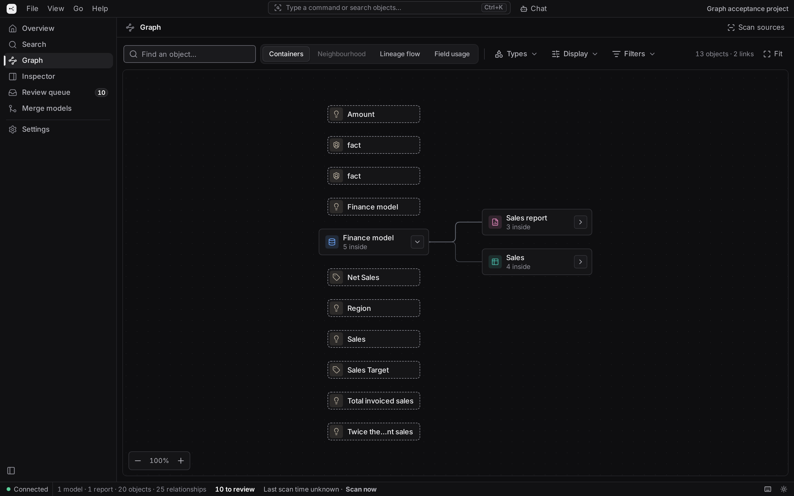
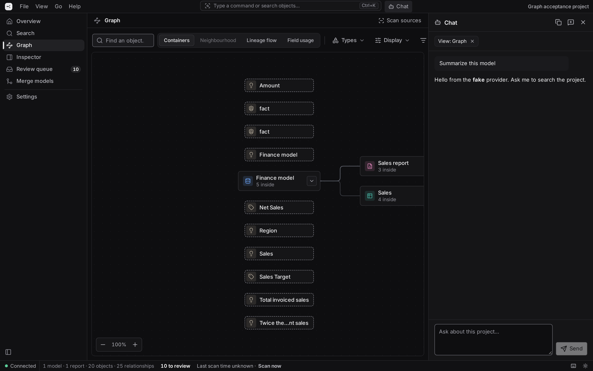
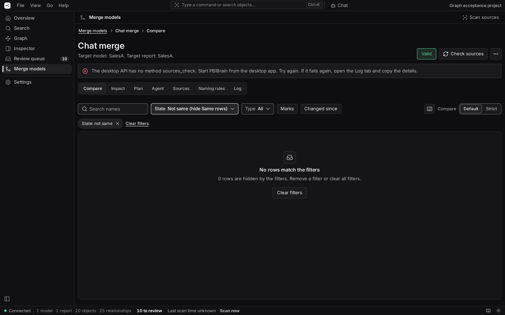
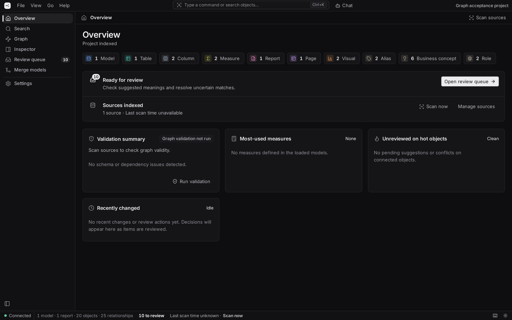
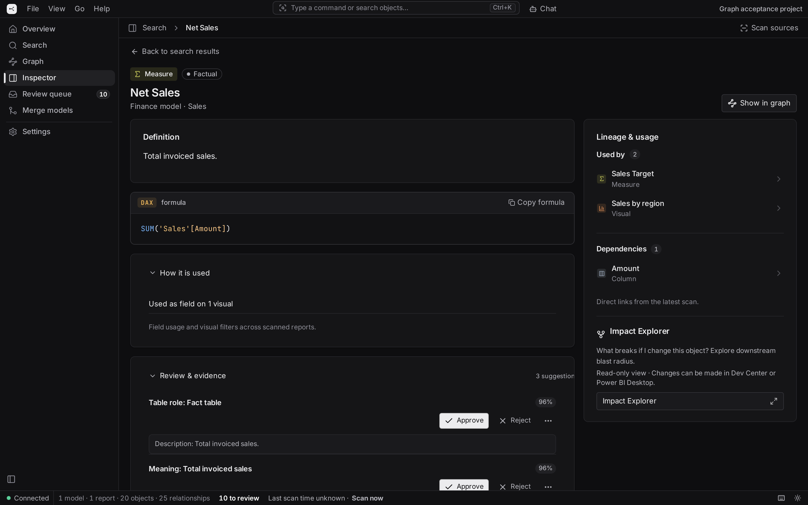

# Power BI Brain

A semantic graph engine, interactive desktop workbench, and Model Context Protocol (MCP) server for Power BI and Microsoft Fabric.

PBIBrain turns Power BI project files (`.pbip`, TMDL, PBIR) and cloud semantic models/reports into a unified, provenance-tracked semantic graph. It gives developers and AI coding agents a shared, authoritative understanding of data models, DAX dependencies, report bindings, and upstream data sources.

---

## At a Glance: GUI + MCP

PBIBrain provides two complementary ways to work with your Power BI ecosystem:

1. **Interactive Workbench (GUI):** A desktop and web application for visual graph exploration, DAX inspection, semantic reviews, side-by-side model merging, in-app AI chat, and automated documentation.
2. **Model Context Protocol (MCP) Server:** A stdio server (`brain mcp`) providing 17 specialized tools for AI coding assistants (Claude Desktop, Cursor, Gemini, Copilot) to query semantic metadata, trace dependencies, evaluate downstream impact, and guide model merges.

---

## Visual Showcase

### Interactive Knowledge Graph
Explore relationships between data sources, tables, columns, measures, calculation groups, and report visuals with hardware-accelerated React Flow visualization.


### In-App AI Chat & Agent Assistance
Query your model directly using the docked AI chat (`Ctrl+J`) powered by local LLMs or cloud providers, using the same tools as the MCP server.


### Development Center (Merge Models)
Compare models side by side, align drifted measures, resolve naming conflicts, run change-safety guards, and deploy changes to local PBIP or cloud workspaces.


### Project Overview & Health
View cross-model commonality, duplicated business logic, orphan objects, and unresolved bindings across all configured sources.


### Deep Object & DAX Inspector
Inspect exact ANTLR-parsed DAX abstract syntax trees (AST), filter modifications, relationship activations, and complete provenance evidence.


---

## Core Capabilities

### 1. Interactive Workbench (GUI)
The web and desktop workbench features **7 dedicated views** designed for Power BI developers:
- **Overview:** Project health, scan status, summary metrics, and cross-model commonality (identical, drifted, renamed, and unique objects).
- **Search:** Global semantic and keyword search across models, tables, measures, and reports.
- **Graph:** Interactive topological map with node clustering, edge filtering (`DEPENDS_ON`, `REFERENCES`, `USES`, `SOURCES_FROM`), and neighborhood focusing.
- **Inspector:** Detailed view of any node—DAX formula with syntax highlighting, AST analysis, filter contexts, report visual bindings, and evidence trail.
- **Review Queue:** Human-in-the-loop review workflow for inferred business concepts, selectors, and conflict resolution.
- **Merge Models (Development Center):** Structured model comparison and consolidation. Compare schemas, resolve differences, enforce removal policies, simulate impact, and apply guarded changes.
- **Settings:** Customize project paths, graph color palettes, and configure local or cloud AI providers.

**Built-in Productivity Features:**
- **In-App AI Chat (`Ctrl+J`):** Docked conversational panel supporting Anthropic, OpenAI-compatible APIs, or local LLMs (Ollama) with context chips for active selections.
- **Command Palette (`Ctrl+K`):** Fast keyboard-first navigation and action launcher.
- **Documentation Export:** Generate complete, styled PDF or Markdown project documentation with table of contents, diagrams, and measure catalogues.

---

### 2. Model Context Protocol (MCP) Server
PBIBrain exposes a standard stdio MCP server for agentic workflows:

```powershell
brain --config C:\Reports\brain.json mcp
```

* **17 Unified Tools:** Includes `brain_overview`, `brain_search`, `brain_object`, `brain_context`, `brain_impact`, `brain_graph`, `brain_commonality`, `session_get`, `plan_validate`, and `proposal_submit`.
* **Hybrid Operation:** Answers directly from the active live application when running, or falls back to the read-only `.pbibrain/agent-snapshot.json` snapshot when the app is closed.
* **Token Budgeting:** Every tool response adheres to strict JSON character budgets to prevent LLM context-window exhaustion.

#### Connecting to Claude Desktop / Cursor
Add the following to your `claude_desktop_config.json` or cursor MCP settings:

```json
{
  "mcpServers": {
    "pbibrain": {
      "command": "brain",
      "args": ["--config", "C:\\path\\to\\brain.json", "mcp"]
    }
  }
}
```

---

### 3. Guarded Model Merging & Deployment
The Development Center lets teams consolidate diverging models safely:
* **Alignment Engine:** Matches objects across models using stable native `lineageTag` identifiers, names, and normalized DAX logic.
* **Change Guards:** Enforces strict safety rules (e.g. preventing unreferenced measure deletions or broken visual bindings) defined in `docs/CHANGE_GUARD_CONTRACT.md`.
* **Multi-Target Deployment:** Deploy merged changes locally to PBIP TMDL files or directly to Microsoft Fabric / Power BI Service via XMLA delta deployment and Fabric REST report updates.
* **Reversible Actions:** Automated pre-apply TMDL backups and one-click undo support.

---

### 4. Static DAX & Data-Source Lineage
* **Deterministic Parsing:** ANTLR4-powered DAX parser resolves variables, dependencies, filter propagation (`CALCULATE`, `KEEPFILTERS`), and relationship activations (`USERELATIONSHIP`).
* **Power Query (M) Lineage:** Statically inspects partition M queries to trace upstream sources (`Sql.Database`, `Lakehouse.Contents`, `File.Contents`, `Dataflows`, SharePoint, etc.) without executing code or needing database credentials.

---

## Quickstart

### Prerequisites
* Windows PC (for native LadybugDB support).
* Python 3.11+.
* Node.js 20+ (for building the frontend).
* LadybugDB shared library (`lbug_shared.dll` on PATH or specified via `LBUG_C_API_LIB_PATH`).

### Installation

```powershell
# 1. Clone repository
git clone https://github.com/DanielSzabo92/PBIBrain.git
cd PBIBrain

# 2. Install Python package in editable mode
python -m pip install -e .

# 3. Build frontend interface
cd frontend
npm ci
npm run build
cd ..

# 4. Start the unified app (UI + API)
brain serve
```

Open `http://127.0.0.1:8000/` in your browser.

---

## Project Configuration (`brain.json`)

Each project uses a single configuration file defining local PBIP files and cloud items:

```json
{
  "version": 1,
  "name": "Finance & Sales Analytics",
  "sources": [
    "C:\\Reports\\Finance\\Finance.pbip",
    "C:\\Reports\\Sales\\Sales.pbip"
  ],
  "cloud_sources": [
    {
      "kind": "cloud_model",
      "workspace_id": "9b1deb4d-3b7d-4b69-9c59-...",
      "workspace_name": "Production Fabric Workspace",
      "item_id": "e81d7f42-...",
      "name": "Corporate Semantic Model",
      "access_type": "Read/Write"
    }
  ],
  "database": "brain.lbug",
  "identity_map": "identity.json"
}
```

Scan all configured sources into the graph:
```powershell
brain --config C:\Reports\brain.json project-scan
```

---

## CLI Command Reference

All commands support `--config <path/to/brain.json>`:

| Command | Description |
| :--- | :--- |
| `brain serve` | Starts the unified web workbench and local HTTP API. |
| `brain mcp` | Runs the stdio Model Context Protocol (MCP) server for AI assistants. |
| `brain project-scan` | Ingests and links all configured local PBIP and cloud sources. |
| `brain scan <path>` | Scans a single `.pbip` project or standalone model JSON file. |
| `brain status` | Displays summary counts of canonical nodes and edges in the graph. |
| `brain search <query>` | Searches canonical objects by name, description, or property. |
| `brain retrieve <query>`| Ranked, paginated semantic search designed for agent tool calls. |
| `brain object <id>` | Dumps full metadata and properties for an exact object ID. |
| `brain context <id>` | Retrieves scoped evidence subgraph (dependencies, usage, semantics). |
| `brain impact <id>` | Evaluates conservative downstream blast radius of proposed changes. |
| `brain compare <a> <b>`| Compares two snapshot documents or models. |
| `brain export-docs` | Exports formatted project documentation as PDF or Markdown. |
| `brain export-markdown`| Exports deterministic markdown dump of the canonical snapshot. |
| `brain config` | Validates and displays resolved configuration paths. |

---

## Project Architecture

```text
PBIBrain/
├── backend/
│   ├── api/            # WSGI HTTP server and local API endpoints
│   ├── chat/           # In-app AI chat engine and provider clients
│   ├── cli/            # `brain` CLI commands and parsers
│   ├── context/        # Task-scoped context compiler for LLM retrieval
│   ├── dax/            # ANTLR4 DAX lexer, parser, and semantic analyzer
│   ├── devcenter/      # Merge models engine, TOM bridge, and apply workflows
│   ├── diff/           # Model and object diff comparison algorithms
│   ├── graph/          # Canonical ontology and LadybugDB persistence layer
│   ├── impact/         # Downstream dependency and usage impact analyzer
│   ├── mcp_server.py   # Stdio Model Context Protocol (MCP) server implementation
│   ├── scanner/        # PBIP, TMDL, PBIR, and cloud artifact ingestion
│   └── tool_registry.py# Shared 17-tool definitions for MCP and Chat
├── frontend/           # Vite + React + Tailwind + @xyflow/react workbench
├── docs/               # Technical specs, architecture decision records (ADRs)
└── tests/              # Comprehensive Python and Playwright test suites
```

---

## Documentation Links

* [Agent Integration & MCP Guide](docs/AGENT_GUIDE.md): MCP tool schemas, reply budgets, and snapshot contracts.
* [Change Guard Contract](docs/CHANGE_GUARD_CONTRACT.md): Invariants and safety guarantees during model merges.
* [Development Center Technical Design](docs/DEV_CENTER_TECHNICAL_DESIGN.md): Architecture of model alignment and XMLA/Fabric deployments.
* [Desktop Distribution Guide](docs/DESKTOP.md): Standalone Windows executable and packaging details.

---

## License

MIT License. See [LICENSE](LICENSE) for details.
